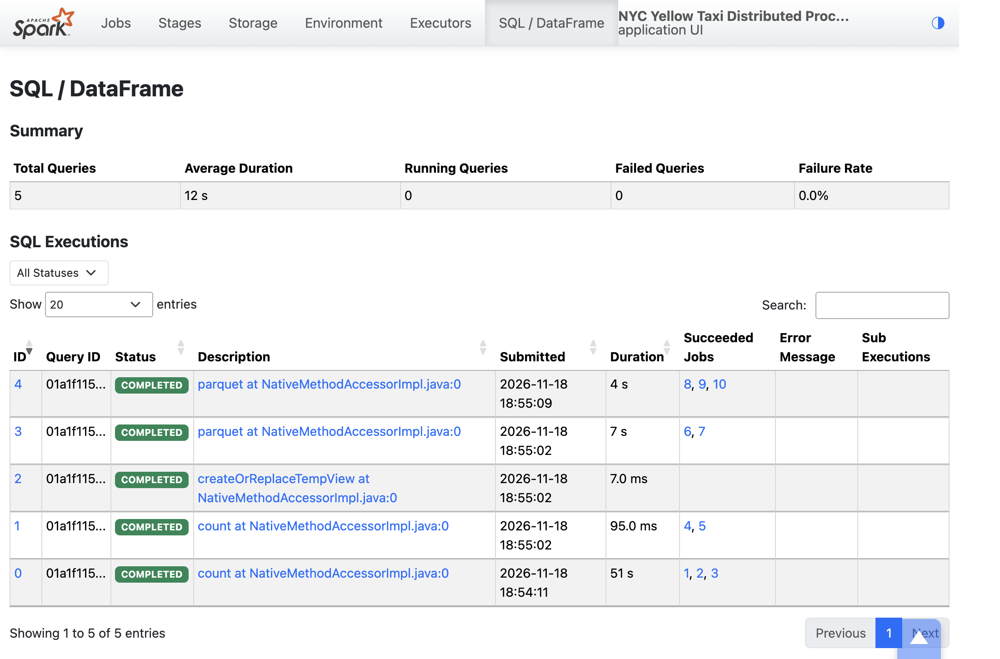
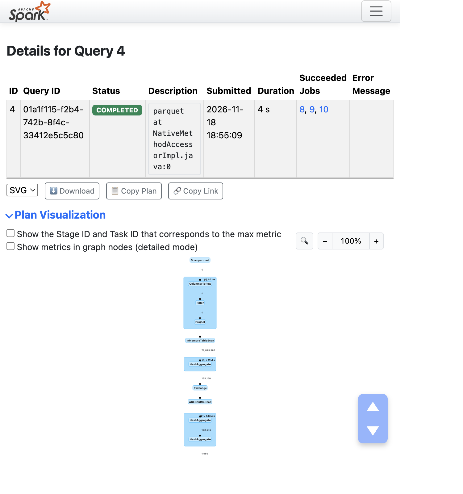

# NYC Yellow Taxi PySpark Pipeline

I completed this project to process NYC Taxi & Limousine Commission (TLC)
Yellow Taxi trip records with PySpark. The pipeline demonstrates lazy
transformations, eager actions, Parquet predicate and column pushdown, SQL,
aggregation, caching, and partitioned output.

## Dataset

- **Dataset:** NYC TLC Yellow Taxi Trip Records, 2023–2024
- **Source:** [NYC TLC Trip Record Data](https://www.nyc.gov/site/tlc/about/tlc-trip-record-data.page)
- **Files:** Monthly Parquet files published at
  `https://d37ci6vzurychx.cloudfront.net/trip-data/yellow_tripdata_YYYY-MM.parquet`
- Two years are used because one year's compressed files are below 1 GB. The
  pipeline processes the inclusive year range and checks that the Parquet input
  totals at least 1 decimal GB by default.

Download both years (24 files) into the expected directory:

```bash
mkdir -p data/raw/yellow_tripdata_2023_2024
for year in 2023 2024; do
  for month in {01..12}; do
    curl -fL "https://d37ci6vzurychx.cloudfront.net/trip-data/yellow_tripdata_${year}-${month}.parquet" \
      -o "data/raw/yellow_tripdata_2023_2024/yellow_tripdata_${year}-${month}.parquet"
  done
done
```

The raw files are not included in the repository. To try the pipeline with a
smaller sample, pass `--minimum-input-gb 0`.

## Run

Requires Python and Java supported by the selected PySpark release. Install
PySpark and run with a local Spark master:

```bash
python -m pip install -r requirements.txt
spark-submit --master 'local[4]' --driver-memory 8g pipeline.py \
  --shuffle-partitions 64
```

I ran a focused pytest check for invalid-trip filtering and derived columns:

```bash
python -m pytest -q
```

The defaults read `data/raw/yellow_tripdata_2023_2024` and write:

- `data/processed/yellow_taxi_2023_2024/daily_zone_metrics`
- `data/processed/yellow_taxi_2023_2024/pickup_zone_summary`

Use `--input`, `--output`, `--start-year`, and `--end-year` to change those
defaults. Existing output paths are protected; use a new `--output` path or
explicitly pass `--overwrite` to replace them. The pipeline uses 200 initial
shuffle partitions with adaptive coalescing; tune via `--shuffle-partitions`
when appropriate for the cluster.

## Pipeline and queries

The pipeline projects the six fields it needs from the source, then filters
null/invalid timestamps, trips outside the selected year range, non-positive or
implausible distances, negative amounts, and non-positive or over-four-hour
durations. It adds `trip_duration_min`, `pickup_date`, and `pickup_month` with
`withColumn`, then groups by date, month, and pickup zone. This is the complex
aggregation instead of a join across multiple datasets.

Two Spark SQL queries run over the daily-zone aggregate:

1. Select daily zone metrics for date/zone groups with at least 100 trips.
2. Rank the top 20 pickup zones by total trips, with weighted average duration
   and total revenue.

The daily aggregate retains unrounded averages and sums internally; SQL rounds
only displayed output values so the zone-level weighted duration and revenue
are calculated from full-precision aggregates.

Both query results are written as Parquet. Daily metrics are partitioned by
pickup month to support month-scoped reads without creating a partition for
every date or zone.

## Lazy evaluation, actions, and cache

DataFrame selection, filters, `withColumn`, `groupBy`, and SQL query
construction are transformations: Spark builds a logical plan and does not
process the records yet. Calling `.explain(mode="formatted")` prints the
physical plan without executing the query. The script's `.count()` calls and
Parquet writes are actions that trigger Spark jobs.

The valid-trip DataFrame is cached before two identical counts. The first count
materializes the cache; the second can reuse cached partitions. The script
prints both elapsed times, but the second is not guaranteed to be faster on
every run (for example, filesystem and OS caches, memory pressure, and cluster
load affect timings). The cache is unpersisted when those actions and writes
finish.

## Performance analysis

The projection and source filters are placed before derived columns and
aggregation. For Parquet, Spark can use column pruning to read only the six
referenced source columns and push supported timestamp, distance, fare, and
amount predicates toward the scan. Verify the actual `PushedFilters` and
`ReadSchema` in the printed formatted plan; whether a predicate is pushed
depends on the file schema and Spark version. Catalyst can combine and
reorder compatible predicates, so their textual order should not be mistaken
for a guarantee about scan execution.

The date/zone `groupBy` requires a shuffle to bring matching keys together.
Adaptive Query Execution and partition coalescing are enabled to help manage
shuffle partitions; the initial count is configurable, and a suitable value
depends on input size and cluster parallelism. The monthly output layout makes
later month-filtered reads more selective, but writing partitioned output also
has a cost. No unnecessary pre-aggregation `repartition` or large-dimension
broadcast join is introduced.

### Full dataset run

I completed the full local run with Spark 4.3.0, Java 17, `local[4]`, an 8 GiB
driver heap, and 64 initial shuffle partitions with AQE enabled. The 24 TLC
Parquet files totaled **1.33 GB**. After data-quality and duration filters,
the pipeline counted **76,845,969 trips**.

- First count action, including cache materialization: **50.53 s**
- Repeated count using the cached DataFrame: **0.11 s**
- Daily-zone SQL output: **43,275 rows** (date/zone groups with at least 100
  valid trips)
- Both daily-zone and pickup-zone Parquet writes completed; the Spark UI
  recorded **5 completed SQL executions and 0 failed**.
- In the two-year summary, pickup zone ID **132** ranked first with
  **3,782,553 trips**, a **42.86 minute** weighted average trip duration, and
  **$310.1 million** in summed TLC `total_amount`.

The repeated count is much faster because its input partitions were cached;
this is a local result, not a general cluster benchmark. The main processing
bottleneck visible in the plan is the shuffle required by the date/month/zone
aggregation. The zone rollup/top-20 query adds another aggregation and
shuffle. Spark performs partial hash aggregation before the exchange, reducing
the volume shuffled relative to sending every trip row across the network.

The formatted plan's Parquet scan reports a six-column `ReadSchema` and
`PushedFilters` for the pickup-year range, trip distance, fare, and total
amount, in addition to non-null checks. The timestamp/dropoff ordering and
derived-duration checks remain in Spark's filter operator. Column pruning
avoids reading the other TLC fields. AQE coalesces shuffle partitions when
appropriate; the initial count is configurable because an ideal setting
depends on the data and available cores.

### Key findings

The date/zone threshold query retained 43,275 daily groups meeting the 100-trip
cutoff. In the aggregate across both years, zone 132 had the largest trip
count. Its average duration and summed `total_amount` differ substantially
from other high-volume zones, so trip volume alone does not describe zone
workload or amount patterns. Zone IDs are reported rather than names because
the pipeline uses only TLC trip records and does not join a zone lookup table.

## Spark UI screenshots

I captured these screenshots from the full local run:





The SQL execution detail screenshot shows a completed Parquet write, the
physical plan (scan, filter, project, in-memory scan, hash aggregates,
exchanges, and output write), and associated job/task metrics. The formatted
plans and actual `PushedFilters`/`ReadSchema` are also printed by `pipeline.py`.

## Conclusion

My economics background helped me understand that trip volume alone does not
measure a pickup zone's economic activity: time spent per trip and recorded
amounts also matter. In this dataset, zone 132 had the most trips and a
substantially longer weighted average trip duration than other busy zones.
This is a descriptive finding, not evidence that zone location causes longer
trips or higher revenue.
